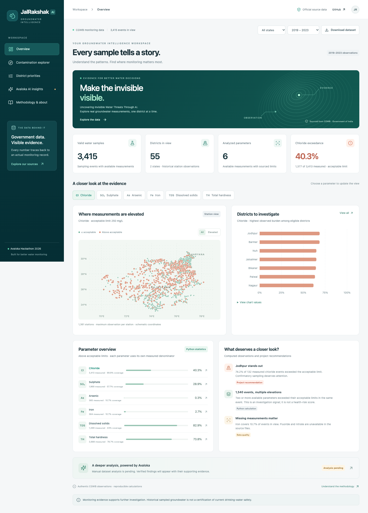

# JalRakshak AI

**Uncovering Invisible Water Threats Through AI.**

An environmental intelligence application for the Avaloka Hackathon 2026, built around one decision: **where should groundwater monitoring be prioritized, and what evidence supports that recommendation?**

**Live website:** https://jalrakshak-ai-opal.vercel.app  
**Repository:** https://github.com/rajsingh1301/JalRakshakAI



## Implemented

- Five responsive React pages: overview, contamination explorer, district priorities, Avaloka AI insights, methodology/about.
- Actual CGWB observations: **3,415 sampling events**, **55 districts**, **1,362 station identities**, **Haryana and Rajasthan**, **2019–2023**.
- Six available parameters with verified reference thresholds: chloride, sulphate, arsenic, iron, dissolved solids and hardness.
- State, sampling year, district and parameter filters; source-record search, pagination and CSV exports.
- Geographic station view, district comparisons, concentration distributions and annual observed burden with actual denominators.
- Parameter-specific monitoring priorities, coverage gates, explicit evidence bands and per-district explanations.
- Missing-data audits, source hashes, original row references and a reproducible Python processing pipeline.
- Manual Avaloka web workflow, upload-ready CSV and validated import format for genuine reviewed outputs.
- Vercel production deployment and connected GitHub repository; automated validation workflow.

**Remaining submission requirement:** genuine Avaloka web analysis results have not yet been supplied, reviewed or imported. The AI Insights page intentionally shows **Analysis pending**. Python statistics are never described as Avaloka findings.

## Problem and solution

Government groundwater records are valuable, but comparing districts without understanding missing measurements can produce misleading recommendations. JalRakshak makes measured exceedances and sampling gaps visible together. A district with sparse records cannot acquire a confident numeric rank merely because a single concentration is extreme.

The application supports further investigation; it does not certify district water safety, predict health outcomes or treat monitoring stations as a representative household survey.

## Dataset

Source: [CGWB manual groundwater chemical parameters, National Water Data Portal](https://nwdp.nwic.gov.in/en/dataset/ground-water-quality-manual-chemical-parameters-cgwb-f-gfg), Government of India. Retrieved **12 October 2026**.

Two preserved official CSVs contain 19,383 source rows. We selected every 2019–2023 event independently of concentration. The **902,954-byte** file for Avaloka and the submission form is:

```text
data/processed/avaloka-ready.csv
```

Original download URLs, checksums, coverage and quality warnings are in `data/processed/provenance.json`. Fluoride and nitrate columns are genuinely empty in the downloaded resources; alkalinity is empty in the selected period. No substitute measurements are generated.

## Local setup

Requires Node.js 22+ and Python 3.13 for the tested environment.

```sh
git clone https://github.com/rajsingh1301/JalRakshakAI.git
cd JalRakshakAI
npm ci
npm run dev
```

The frontend reads preprocessed static JSON. It runs without API credentials or a Python server.

To reproduce the authentic dataset and metrics:

```sh
python3 -m venv .venv
.venv/bin/pip install -r requirements.txt
.venv/bin/python scripts/prepare_dataset.py
.venv/bin/python scripts/process_data.py
```

Original datasets are already preserved in the repository. Raw data is not copied into the public deployment; only the small cleaned subset and dashboard JSON are intentionally served.

## Avaloka’s exact role

The selected integration is **manual analysis through https://app.avaloka.ai**, as requested by the user. No Avaloka token is required and authenticated API integration is not claimed.

1. Upload `data/processed/avaloka-ready.csv`.
2. Ask the actual dataset-specific questions in [AVALOKA_PROMPTS.md](docs/AVALOKA_PROMPTS.md).
3. Save original responses/artifacts and actual dataset/project identifiers.
4. Check values and denominators against the actual measurements.
5. Fill `data/avaloka-import-template.json` with genuine, reviewed findings and preserve text evidence.
6. Import:

```sh
.venv/bin/python scripts/import_avaloka.py /path/to/reviewed-results.json
.venv/bin/python scripts/process_data.py
npm test
npm run build
```

The importer checks schema, dataset hash, explicit review status and original text evidence; it cannot automatically prove the factual correctness or service origin of a response. Human review and original Avaloka exports are essential. Pending/mismatched results cannot render as verified insights.

See [AVALOKA_ANALYSIS.md](docs/AVALOKA_ANALYSIS.md) for the evidence ledger and exact remaining steps.

## Architecture and methodology

```text
Official CGWB CSVs → Python cleaning/validation → upload-ready CSV
                                          ├→ Manual Avaloka analysis → reviewed original findings
                                          └→ Python parameter metrics → static dashboard JSON
                                                               ↓
                                        React filters, charts and monitoring priorities → Vercel
```

Thresholds follow the [Government of India BIS IS 10500:2012 extract](https://www.pib.gov.in/Pressreleaseshare.aspx?PRID=1843385&lang=2&reg=48). Acceptable and permissible limits are kept separate. Exceedance means strictly greater than the limit; valid per-parameter measurements supply the denominator.

For one selected parameter, eligible districts sort by observed exceedance proportion; ties use median exceedance-to-limit ratio, measured count and name. Eligibility requires at least 10 measured events, 5 stations and 50% parameter coverage. High ≥40%, moderate ≥15% and <40%, lower <15% are **project-defined observed burden bands**. Ineligible districts are explicitly marked insufficient evidence.

Full formulas, counts, source units and limitations: [DATA_METHODOLOGY.md](docs/DATA_METHODOLOGY.md).

## Tests and build

```sh
npm test
.venv/bin/python -m unittest discover -s tests -p 'test_*.py'
npm run build
npm run test:e2e
```

Browser tests use installed Google Chrome on macOS. On Linux/CI, install Chromium with `npx playwright install --with-deps chromium` before running them.

**Executed successfully:** 7 calculation tests, 5 original-data integrity tests, 10 local browser tests, and the same 10 browser tests against the public Vercel site. Production builds passed locally and remotely. Evidence and limits: [TESTING.md](docs/TESTING.md).

## Deployment

The project is linked to Vercel **jalrakshak-ai**. The public production alias is **https://jalrakshak-ai-opal.vercel.app**. Its homepage/data return HTTP 200 without login.

GitHub is connected to Vercel for deployments on pushes. To deploy from another authorized machine:

```sh
vercel login
vercel link --yes --project jalrakshak-ai
vercel deploy --prod --yes
```

The static output is `dist/`, configured in `vercel.json`. Navigation uses hash routes, so page refresh works without server routing rules. No visitor API calls or secrets are needed. `.env*`, `.venv/` and `.vercel/` remain ignored.

The user-requested Vercel CLI/plugin/MCP setup is documented in [VERCEL_SETUP.md](docs/VERCEL_SETUP.md). Plugin tools require a new session to load; deployment was verified through authenticated CLI access.

## Stack and structure

React 19, Vite, Tailwind CSS, Recharts, Lucide, Python/Pandas/NumPy, Playwright, GitHub Actions, Vercel.

```text
src/components/        Shared UI, charts and geographic station view
src/pages/             Five application pages
src/utils/             Filters, statistics, deterministic ranking and CSV export
scripts/               Dataset preparation, metrics and genuine Avaloka import
data/raw/              Untouched official source CSVs
data/processed/        Cleaned upload CSV, provenance and dashboard outputs
data/avaloka-insights.json   Genuine imported findings, currently pending
public/data/           Small public dataset, JSON and reviewed evidence
docs/                  Methodology, analysis ledger, testing and submission answers
tests/                 Calculation, original-data and browser checks
```

## Limitations and next improvements

Historical monitoring stations are not current household drinking-water evidence. Coverage varies sharply by year and parameter, especially sparse arsenic/iron measurements and only two Rajasthan records in 2022. Published zeros lack detection-limit metadata. District boundaries are not harmonized across years. Annual charts are not controlled trend estimates.

Next steps are genuine Avaloka evidence import, more recent authenticated source measurements, additional geographic coverage, station identifiers and detection-limit/QA metadata. Confidence estimates require an appropriate sampling design rather than treating repeated observations as independent.

## Submission

Prepared answers: [SUBMISSION_ANSWERS.md](docs/SUBMISSION_ANSWERS.md).

**Do not submit until the actual Avaloka findings are documented.** The Google Form has not been submitted; final submission requires the user’s explicit approval and personal name/email.
